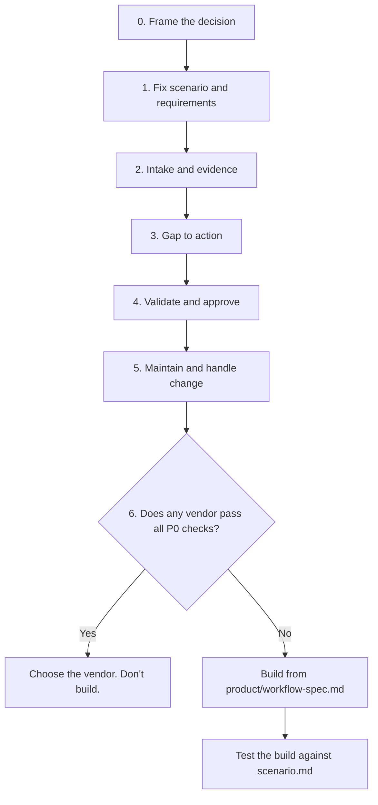

# RoPA Workspace

A step-by-step process for two jobs that share one backbone:

1. **Evaluate** RoPA (Article 30 GDPR) tools fairly, for a client or yourself.
2. **Build** an evidence-backed RoPA workspace for SMEs and external DPOs.

The product idea in one line: turn existing documents into reviewable records, keep owners accountable, and say exactly what is still unverified.

This is a product hypothesis, not a proven market gap. Existing tools already cover parts of mapping, workflow, risk and automation. The Evaluate track is how you test that before you build.

## The process at a glance



More diagrams (the two lanes, the evidence rule, record states, change handling) are in [docs/workflow-map.md](docs/workflow-map.md).

## Start here

1. Read [PROCESS.md](PROCESS.md). Seven steps, each with an Evaluate lane, a Build lane, one output and a "done when" check.
2. Fill the framing block at the top of [scenario.md](scenario.md).
3. Run the demo with the fictional inputs in [demo-data/](demo-data/).

## Repo map

```
PROCESS.md                          the step-by-step process (both lanes)
scenario.md                         the one scenario every demo and spec is tested against
docs/
  workflow-map.md                   diagrams: process, lanes, evidence rule, states, change handling
demo-data/                          fictional inputs for the scenario (Lumen Outdoor AB)
  excel-register.xlsx / .csv        messy existing register
  contracts-pdf/                    CRM, payroll and AI-support contract summaries
  contracts/                        same, as editable markdown
  retention-policy.md               covers some activities, not all
  answer-key.md                     12 planted findings to score tools against
evaluation/
  weights.csv                       scoring criteria and weights (editable)
  scorecard.csv                     score vendors 0-5 per criterion
  demo-script.md                    scenario as a live demo run sheet with pass/fail checks
  procurement-questions.md          written questions for vendors (hosting, access, exit)
product/
  mvp-requirements.md               P0/P1/P2 features
  ropa-record-template.md           controller and processor records with source/status/owner
  workflow-spec.md                  states, gap-to-action rules, change triggers, data model
```

## How the two lanes connect

- The P0 list in `product/mvp-requirements.md` is also the must-have list when you score vendors.
- Whatever vendors do badly in the demos is your differentiation if you build.
- If every vendor passes the P0 checks, don't build. Pick one.

## Using it

Fork or copy per client. Fill `scenario.md` first, then follow PROCESS.md in order. Change the weights in `evaluation/weights.csv` to match the client, and record the reason in the file.

The demo data is fictional. No real company, person or product is described.

## Legal note

Article 30 content requirements (controller: 30(1), processor: 30(2), exemption: 30(5)) are statutory. The workflow states, evidence columns, priorities and weights are suggested product design, not legal requirements. Check current text and local guidance (for Sweden, IMY) before relying on any of it.

## Status

Draft v0.2. Not legal advice.
