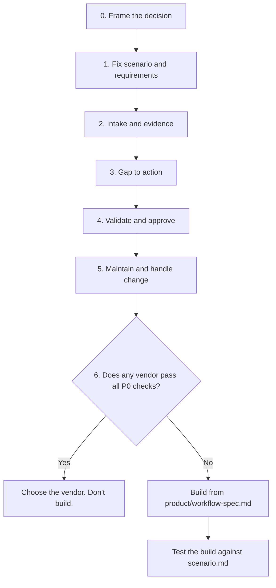
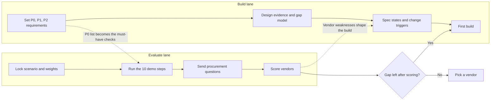
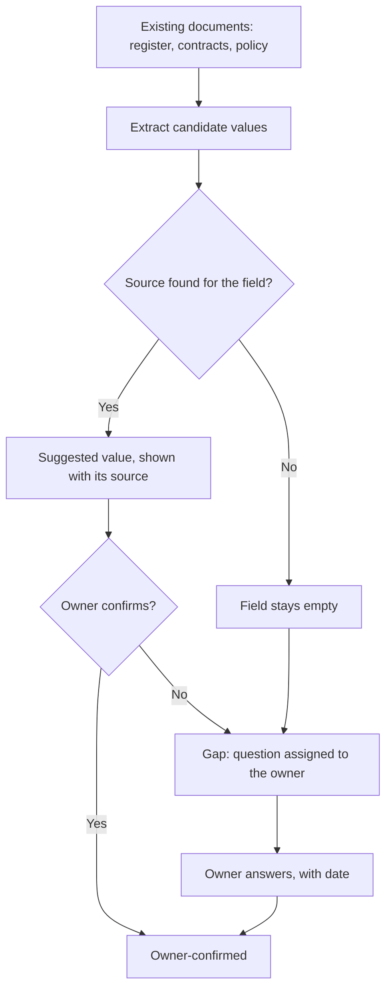
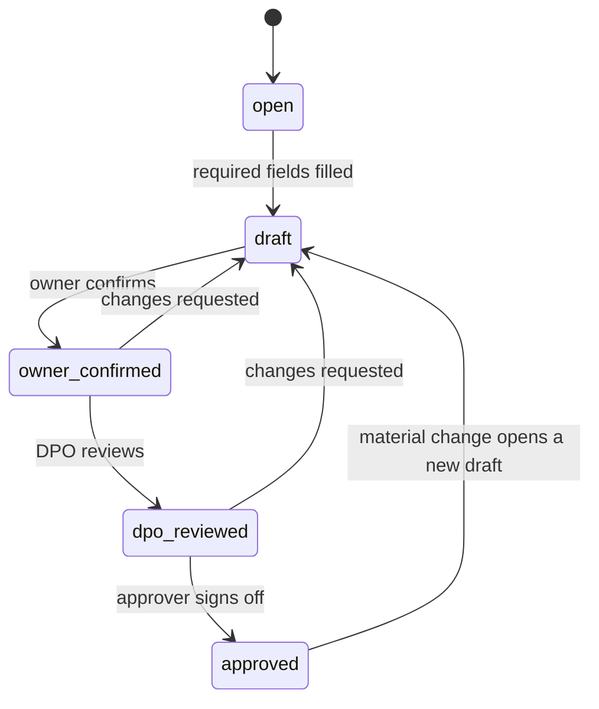
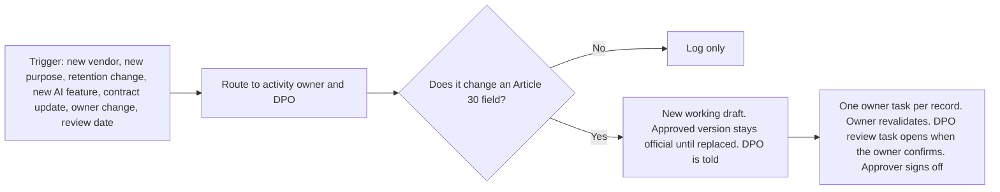

# Workflow map

Visual guide to the process. Diagrams render automatically on GitHub. Full detail is in [PROCESS.md](../PROCESS.md).

## 1. The seven steps, and the decision at the end

## 2. The two lanes and how they feed each other

## 3. Evidence rule: a field is sourced or open

## 4. Record states

The approved version stays official, marked "change pending", until the new draft is approved and replaces it. Details and decisions are in [product/workflow-spec.md](../product/workflow-spec.md), sections 4 and 10.

## 5. Change handling

## Which file belongs to which step

| Step | Evaluate lane | Build lane |
|---|---|---|
| 0 Frame | `scenario.md` (framing block) | `scenario.md` (framing block) |
| 1 Scenario and requirements | `scenario.md`, `evaluation/weights.csv` | `product/mvp-requirements.md` |
| 2 Intake and evidence | `evaluation/demo-script.md` steps 1-2, `demo-data/` | `product/workflow-spec.md` sections 1-2 |
| 3 Gap to action | `evaluation/demo-script.md` step 3 | `product/workflow-spec.md` section 3 |
| 4 Validate and approve | `evaluation/demo-script.md` steps 4, 5, 7 | `product/workflow-spec.md` section 4, `product/ropa-record-template.md` |
| 5 Maintain and change | `evaluation/demo-script.md` step 6 | `product/workflow-spec.md` section 5 |
| 6 Decide or ship | `evaluation/procurement-questions.md`, `evaluation/scorecard.xlsx` (scores, P0 gate) | `product/workflow-spec.md` sections 7-9 |
